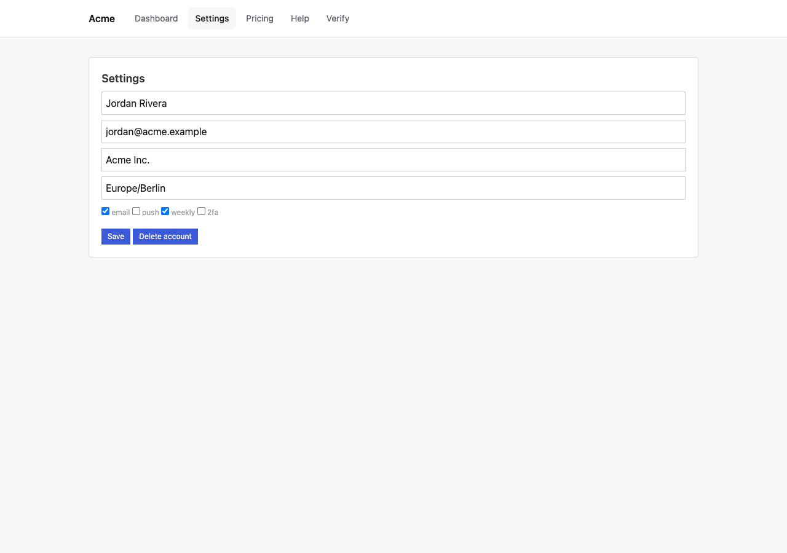
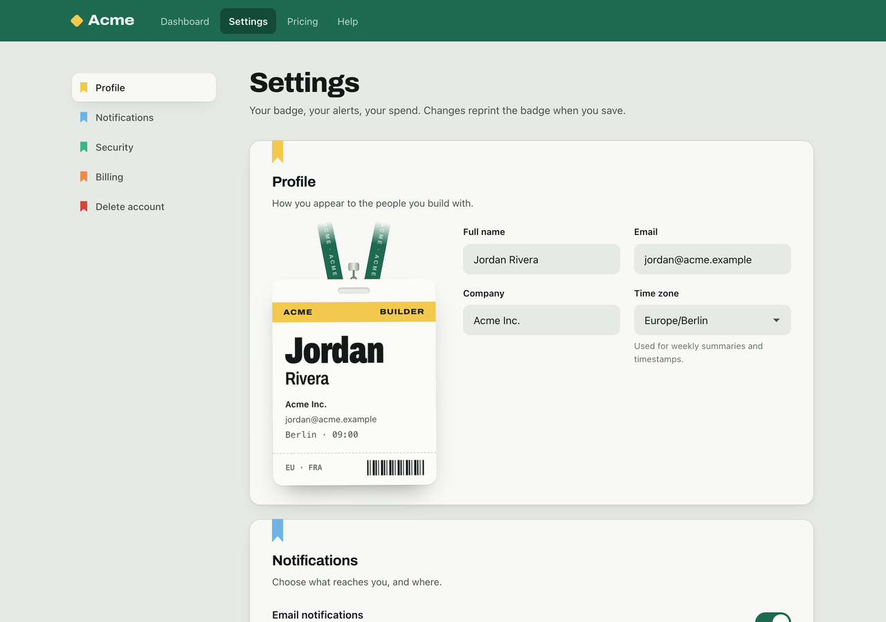
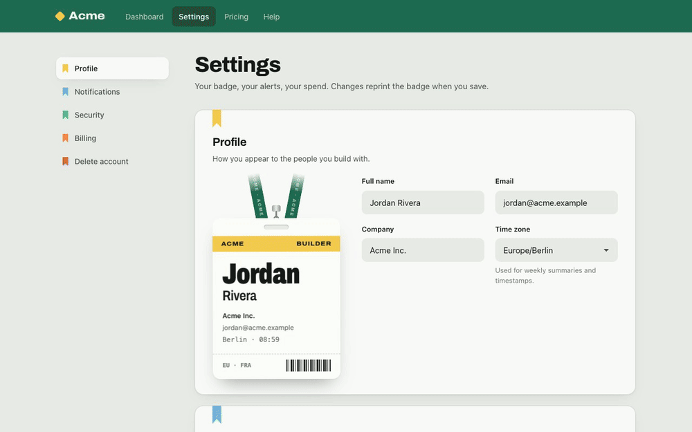
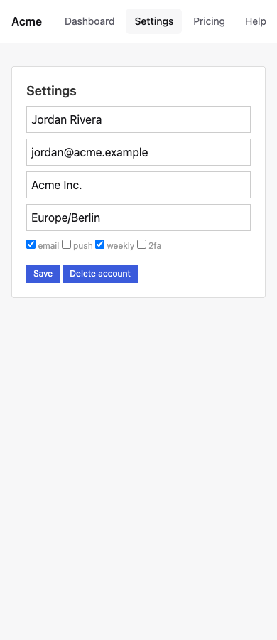
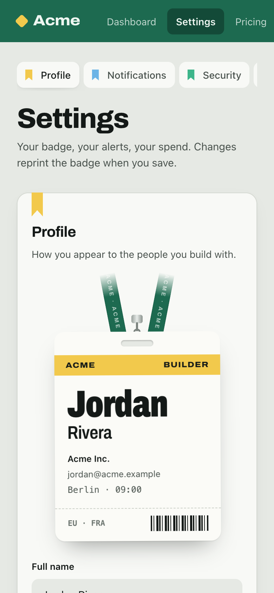
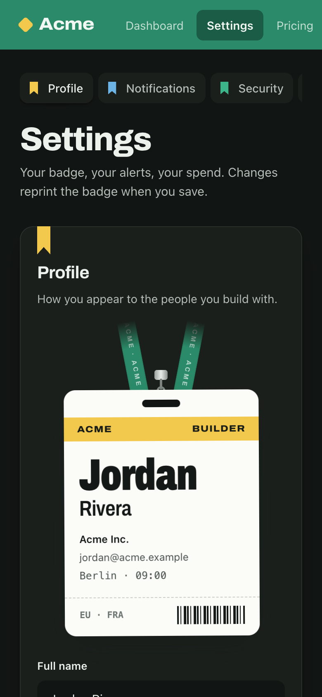
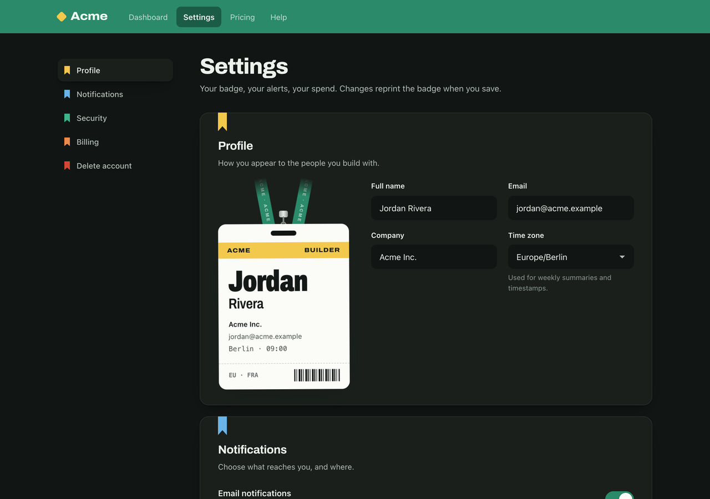

<h1 align="center">UIUX Orchestrator</h1>

<p align="center">
  <b>Your AI agent has a dozen design skills.<br>It needs a design lead.</b>
</p>

<p align="center">
  One skill that decides which expert each UI task needs, builds the result and proves it works.<br>
  Web · React Native · iOS · Android · Flutter
</p>

<p align="center">
  <a href="https://github.com/LongNguyen2312/uiux-orchestrator/actions/workflows/validate.yml"></a>
  
  
  
</p>

---

<table>
  <tr>
    <td align="center"><b>Before</b></td>
    <td align="center"><b>After</b></td>
  </tr>
  <tr>
    <td></td>
    <td></td>
  </tr>
</table>

**The request:** *"Redesign the settings page for indie developers. Give it a real concept that
doesn't look AI-generated."*

<p align="center">
  
</p>

**Concept: "Event Badge".** Your account is the badge you wear at a hackathon:

- ✍️ **Type your name** and the badge updates live, marked as a draft.
- 🛡️ **Turn on two-factor** and a holographic "verified" seal sticks to the badge.
- 🖨️ **Hit save** and the badge reprints.
- 🎗️ **Every section has its own track colour**, like ribbons on a conference badge.

The concept wasn't a guess. The orchestrator classified the task as a full redesign and handed it to
[Impeccable](https://github.com/pbakaus/impeccable) as the design lead. Impeccable put several
grounded directions on a decision page, and a human picked one. Nothing was mocked up: these
images are screenshots of the running page.

<table>
  <tr>
    <td align="center" width="33%"><br><sub>Before · mobile</sub></td>
    <td align="center" width="33%"><br><sub>After · light</sub></td>
    <td align="center" width="33%"><br><sub>After · dark</sub></td>
  </tr>
</table>

---

## Why you need it

Design skills are powerful. Put several together, though, and your agent starts guessing.

| 😩 Without an orchestrator | 😎 With UIUX Orchestrator |
|---|---|
| A one-line fix triggers a whole design pipeline | Small fixes stay small and fast |
| A real redesign gets no expert at all | Every real need gets its single best expert |
| Two skills fight over the same screen | One clear lead per screen, with rulings for overlaps |
| Reanimated 4 code lands in a Reanimated 3 app | It reads your stack and versions first |
| "Make it consistent" wipes your design system | Your tokens and components are kept |
| *"Done ✅"*, and nobody opened the page | Screenshots, contrast, overflow and motion checks, with an honest status |

## Install in 10 seconds

```text
/plugin install uiux-orchestrator --marketplace LongNguyen2312/uiux-orchestrator
```

<details>
<summary>Codex CLI and other agents</summary>

```bash
git clone https://github.com/LongNguyen2312/uiux-orchestrator.git ~/uiux-orchestrator
ln -s ~/uiux-orchestrator/skills/uiux-orchestrator ~/.codex/skills/uiux-orchestrator
```

For updates and other agents, see the [usage guide](docs/usage.md#install-update-remove).
</details>

There are no dependencies and no setup. Just ask:

```text
/uiux-orchestrator The onboarding animation feels dead. Make it smooth.
/uiux-orchestrator Review the dashboard for UX problems. Don't touch the code.
/uiux-orchestrator Build an OTP input that handles paste and autofill.
```

## Numbers, not adjectives

<table>
  <tr>
    <td align="center"><h2>100%</h2>right skills picked<br><sub>vs 50% for the agent alone</sub></td>
    <td align="center"><h2>0%</h2>unnecessary skill runs<br><sub>vs 47% for the agent alone</sub></td>
    <td align="center"><h2>16/16</h2>stacks detected correctly<br><sub>from real project files</sub></td>
  </tr>
</table>

<sub>The scenarios and methods are in the [benchmark](tests/benchmark.md).</sub>

## Speaks every UI stack

<table>
  <tr>
    <td valign="top" width="50%">

**🌐 Web:** React, Next.js, Vue, Angular, Svelte, HTML/CSS<br>
**⚛️ React Native:** Expo and CLI, New Architecture, Reanimated 4<br>
**🍎 iOS:** SwiftUI and UIKit, Liquid Glass, HIG<br>
**🤖 Android:** Compose and Views, Material 3 Expressive<br>
**🐦 Flutter:** Material and Cupertino

Each platform has built-in, version-checked guidance. No other skill is required.
    </td>
    <td width="50%" align="center">
      
    </td>
  </tr>
</table>

## Makes your favourite skills better

Already using these? UIUX Orchestrator knows what each one is best at, what version it targets and
what it changes in your project, and it calls each one only where it adds real value.

[Impeccable](https://github.com/pbakaus/impeccable) ·
[Emil Kowalski](https://github.com/emilkowalski/skills) ·
[UI UX Pro Max](https://github.com/nextlevelbuilder/ui-ux-pro-max-skill) ·
[Anthropic frontend-design](https://github.com/anthropics/skills) ·
[Apple Design](https://github.com/dickwu/apple-design-skill) ·
[Vercel](https://github.com/vercel-labs/agent-skills) · [GSAP](https://github.com/greensock/gsap-skills) ·
[Taste](https://github.com/Leonxlnx/taste-skill) · [Lucian UX/UI](https://github.com/Seokwoooo/lucian-uxui) ·
[Expo](https://github.com/expo/skills) · [Software Mansion](https://github.com/software-mansion-labs/skills) ·
[Callstack](https://github.com/callstackincubator/agent-skills) · [Android](https://github.com/android/skills) ·
[SwiftUI Pro](https://github.com/twostraws/SwiftUI-Agent-Skill)

## Learn more

📘 [Usage guide](docs/usage.md) · ⚙️ [How it works](docs/how-it-works.md) ·
📊 [Benchmark](tests/benchmark.md) · 📝 [Changelog](CHANGELOG.md) · 🤝 [Contributing](CONTRIBUTING.md)

<p align="center">
  <b>If it saves you a redesign, give it a ⭐</b> so other builders can find it too.<br>
  <sub>MIT licensed</sub>
</p>
