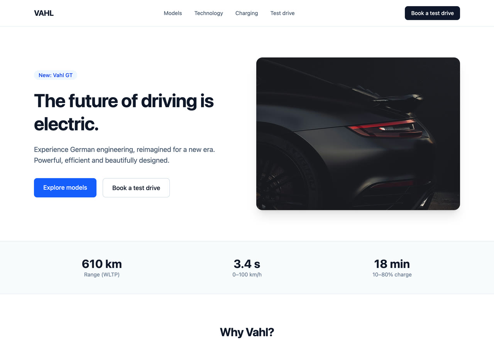
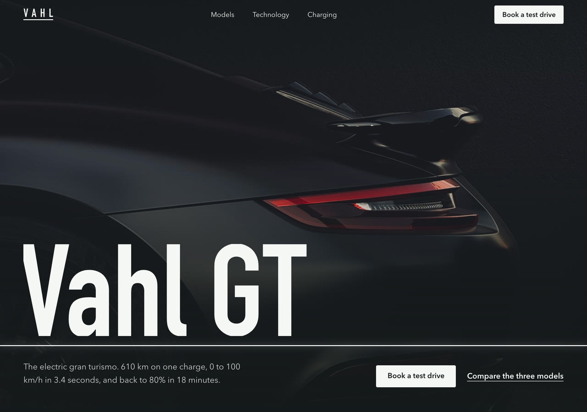
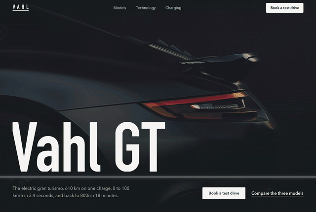
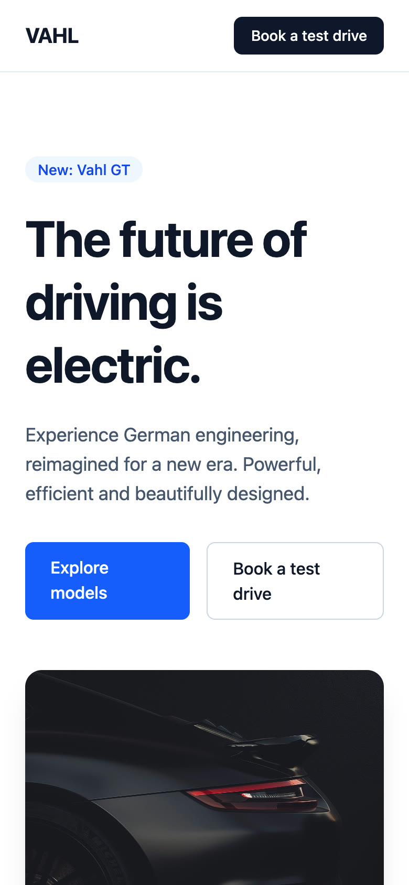
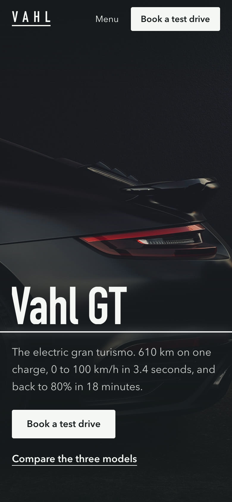
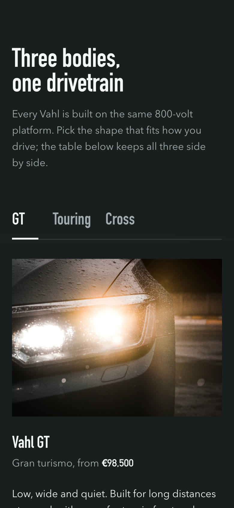
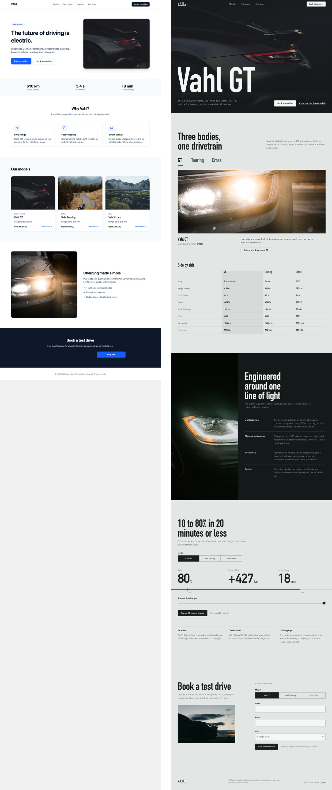

<h1 align="center">UIUX Orchestrator</h1>

<p align="center">
  <b>Your AI agent has a dozen design skills.<br>It needs a design lead.</b>
</p>

<p align="center">
  One skill that decides which expert each UI task needs, builds the result and proves it works.<br>
  Web · React Native · iOS · Android · Flutter
</p>

<p align="center">
  <a href="https://github.com/LongNguyen2312/uiux-orchestrator/actions/workflows/validate.yml"></a>
  
  
  
</p>

---

## One prompt. 23 minutes. No hand edits.

<table>
  <tr>
    <td align="center"><b>Before</b></td>
    <td align="center"><b>After</b></td>
  </tr>
  <tr>
    <td></td>
    <td></td>
  </tr>
</table>

<picture>
  <source srcset="docs/assets/vahl-demo.webp" type="image/webp">
  
</picture>

**The exact prompt**, typed once into Claude Code:

```text
/uiux-orchestrator Redesign the landing page in src/App.tsx for Vahl, a fictional German premium electric car brand with the restraint of Audi. The page works, but it looks like every SaaS template. I want a completely new, art-directed concept that feels like a premium car brand and not like a template or something AI-generated: one strong visual idea, confident typography, a deliberate colour world, and motion that feels engineered (precise and fast, no bouncy gimmicks). It needs a cinematic hero, a way to compare the three models, a technology and charging section, and test-drive booking. Use only the photos in public/cars and don't add npm packages. It must work on mobile, in light and dark mode, and with reduced motion. When you're done, verify it with screenshots and tell me which skills you used and why.
```

*Vahl is a fictional brand made up for this demo.*

### What the orchestrator did

1. **Read the request.** It classified the task as a full redesign that **replaces** the old look,
   for a web landing page.
2. **Read the project.** It found Vite, React 19 and Tailwind v4, the `motion` library already
   installed, six photos and no design system.
3. **Assembled the team.** It brought in four specialists, each for one job:

| Job | Skill it picked | Why this one |
|---|---|---|
| Visual direction (the lead) | [Anthropic frontend-design](https://github.com/anthropics/skills) | Built for a single new page. Taste and Impeccable's full pipeline were set aside because they write their own files into the project or need setup choices only the user can make |
| Motion rules | [Emil Kowalski · animate](https://github.com/emilkowalski/skills) | Decides what moves, which curves and durations, and the reduced-motion version |
| Choreography | [Emil Kowalski · choreograph](https://github.com/emilkowalski/skills) | Orders the hero entrance: line, then name, then copy, then buttons |
| Independent review | [Impeccable · critique](https://github.com/pbakaus/impeccable), in a separate agent | The reviewer never saw the designer's reasoning. It raised 13 issues, and 12 were fixed |

   The GSAP skills were available but not used: the project already had `motion`, and the prompt ruled out
   new packages.
4. **Built one idea, "Lichtlinie" (line of light).** A thin line of light draws across the hero.
   It then returns as the model-tab marker, the charging bar and the focus line in the booking form.
5. **Proved it.**
   - The typecheck and the production build pass.
   - Screenshots at 320 to 1440 px, in light and dark mode and with reduced motion.
   - Frame-by-frame traces: the line draws in about 770 ms with no dropped frames.
   - It clicked and typed through every interaction.

<table>
  <tr>
    <td align="center" width="33%"><br><sub>Before · mobile</sub></td>
    <td align="center" width="33%"><br><sub>After · mobile</sub></td>
    <td align="center" width="33%"><br><sub>After · dark mode</sub></td>
  </tr>
</table>

<details>
<summary><b>See both full pages side by side</b></summary>
<br>

</details>

<sub>Full run log and the agent's own report: [tests/results/2026-11-06-showcase-vahl.md](tests/results/2026-11-06-showcase-vahl.md).
Photos: Pexels ([credits](docs/assets/CREDITS.md)).</sub>

---

## Why you need it

Design skills are powerful. Put several together, though, and your agent starts guessing.

| 😩 Without an orchestrator | 😎 With UIUX Orchestrator |
|---|---|
| A one-line fix triggers a whole design pipeline | Small fixes stay small and fast |
| A real redesign gets no expert at all | Every real need gets its single best expert |
| Two skills fight over the same screen | One clear lead per screen, with rulings for overlaps |
| Reanimated 4 code lands in a Reanimated 3 app | It reads your stack and versions first |
| "Make it consistent" wipes your design system | Your tokens and components are kept |
| *"Done ✅"*, and nobody opened the page | Screenshots, contrast, overflow and motion checks, with an honest status |

## Install in 10 seconds

```text
/plugin install uiux-orchestrator --marketplace LongNguyen2312/uiux-orchestrator
```

<details>
<summary>Codex CLI and other agents</summary>

```bash
git clone https://github.com/LongNguyen2312/uiux-orchestrator.git ~/uiux-orchestrator
ln -s ~/uiux-orchestrator/skills/uiux-orchestrator ~/.codex/skills/uiux-orchestrator
```

For updates and other agents, see the [usage guide](docs/usage.md#install-update-remove).
</details>

There are no dependencies and no setup. Just ask:

```text
/uiux-orchestrator The onboarding animation feels dead. Make it smooth.
/uiux-orchestrator Review the dashboard for UX problems. Don't touch the code.
/uiux-orchestrator Build an OTP input that handles paste and autofill.
```

## Numbers, not adjectives

<table>
  <tr>
    <td align="center"><h2>100%</h2>right skills picked<br><sub>vs 50% for the agent alone</sub></td>
    <td align="center"><h2>0%</h2>unnecessary skill runs<br><sub>vs 47% for the agent alone</sub></td>
    <td align="center"><h2>16/16</h2>stacks detected correctly<br><sub>from real project files</sub></td>
  </tr>
</table>

<sub>The scenarios and methods are in the [benchmark](tests/benchmark.md).</sub>

## Speaks every UI stack

<table>
  <tr>
    <td valign="top" width="50%">

**🌐 Web:** React, Next.js, Vue, Angular, Svelte, HTML/CSS<br>
**⚛️ React Native:** Expo and CLI, New Architecture, Reanimated 4<br>
**🍎 iOS:** SwiftUI and UIKit, Liquid Glass, HIG<br>
**🤖 Android:** Compose and Views, Material 3 Expressive<br>
**🐦 Flutter:** Material and Cupertino

Each platform has built-in, version-checked guidance. No other skill is required.
    </td>
    <td width="50%" align="center">
      
    </td>
  </tr>
</table>

## Makes your favourite skills better

Already using these? UIUX Orchestrator knows what each one is best at, what version it targets and
what it changes in your project, and it calls each one only where it adds real value.

[Impeccable](https://github.com/pbakaus/impeccable) ·
[Emil Kowalski](https://github.com/emilkowalski/skills) ·
[UI UX Pro Max](https://github.com/nextlevelbuilder/ui-ux-pro-max-skill) ·
[Anthropic frontend-design](https://github.com/anthropics/skills) ·
[Apple Design](https://github.com/dickwu/apple-design-skill) ·
[Vercel](https://github.com/vercel-labs/agent-skills) · [GSAP](https://github.com/greensock/gsap-skills) ·
[Taste](https://github.com/Leonxlnx/taste-skill) · [Lucian UX/UI](https://github.com/Seokwoooo/lucian-uxui) ·
[Expo](https://github.com/expo/skills) · [Software Mansion](https://github.com/software-mansion-labs/skills) ·
[Callstack](https://github.com/callstackincubator/agent-skills) · [Android](https://github.com/android/skills) ·
[SwiftUI Pro](https://github.com/twostraws/SwiftUI-Agent-Skill)

## Learn more

📘 [Usage guide](docs/usage.md) · ⚙️ [How it works](docs/how-it-works.md) ·
📊 [Benchmark](tests/benchmark.md) · 📝 [Changelog](CHANGELOG.md) · 🤝 [Contributing](CONTRIBUTING.md)

<p align="center">
  <b>If it saves you a redesign, give it a ⭐</b> so other builders can find it too.<br>
  <sub>MIT licensed</sub>
</p>
